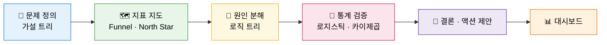

<div align="center">

# ☕ 스타벅스 오퍼 완료율 차이 요인 분석

### 오퍼 구조와 고객 프로필로 읽는 *"무엇이 오퍼를 완료하게 만드는가"*

<br>


**AIFFEL · 주영 없는 주영팀 · Project 2**

<br>

[👤 About Me](#-about-me) ·
[📌 개요](#-프로젝트-개요) ·
[🗂️ 데이터](#️-데이터) ·
[🔬 분석 흐름](#-분석-흐름) ·
[💡 핵심 발견](#-핵심-발견) ·
[✅ 가설 검증](#-가설-검증-결과) ·
[📣 제언](#-비즈니스-제언) ·
[🚀 실행 방법](#-실행-방법)

</div>

<br>

---

## 👤 About Me

<table>
<tr>
<td width="140" align="center">

### 🧑‍💻
**표시철**<br>
<sub>주영 없는 주영팀 팀장</sub>

</td>
<td>

- 🩺 **배경:** 간호학 전공 · **Clinical Data Management 7년** 근무
- 🎓 **현재:** AIFFEL 데이터인텔리전스 1기 수강 중
- 🎯 **프로젝트 역할:** 가설 트리 · 지표 지도 · 원인 분해 · 통계 검증 · 대시보드 디자인 · **발표**
- 📋 **팀 운영:** 팀장, 프로젝트 진행 현황(Project Status) 관리
- 💭 **프로젝트 회고:** 데이터인텔리전스 두 번째 프로젝트였는데, 우연히 첫 번째 프로젝트와 같은 팀원들과 함께 진행하게 되었습니다. 첫 프로젝트에서 아쉬웠던 부분을 보완해 이번에는 더 효율적으로 진행하고 팀원들의 의견을 수용하는 데 신경 썼습니다. 대시보드·PPT·보고서의 미장센을 중요하게 생각하는 편이라, 어느 정도 결론을 도출한 뒤에는 대시보드 디자인에 힘을 실어 작업했습니다. 데이터인텔리전스 과정의 중간 단계를 마무리하며, 다음 프로젝트에서는 더 완성도 있는 결과물을 만들고 싶습니다.
- 📫 **연락처:** [GitHub @Sicheol-Pyo](https://github.com/Sicheol-Pyo) · [gogumagoon@naver.com](mailto:gogumagoon@naver.com)

</td>
</tr>
</table>

<br>

## 📌 프로젝트 개요

> **"같은 오퍼인데, 왜 어떤 오퍼·어떤 고객에게서만 완료율이 높을까?"**

스타벅스 앱의 프로모션 로그(오퍼 발송 → 조회 → 완료)를 활용해 **오퍼 설계 요소와 고객 프로필이 완료율에 미치는 영향**을 분석하는 프로젝트입니다.
**가설 트리 → 지표 지도 → 원인 분해 → 통계 검증** 순서로 진행하고, 채택한 지표만 담은 **인터랙티브 대시보드**까지 제작했습니다.

<table>
<tr>
<td align="center"><b>📨 오퍼 발송</b><br>76,277건<br><sub>(offer received)</sub></td>
<td align="center"><b>👀 수신율</b><br>74.2%<br><sub>56,567건</sub></td>
<td align="center"><b>✅ 수신 후 전환</b><br>53.6%<br><sub>30,320건</sub></td>
<td align="center"><b>🧪 검증 가설</b><br>12개<br><sub>지지 4 · 부분지지 2 · 보류 2 · 기각 4</sub></td>
</tr>
</table>

> 📊 **[인터랙티브 대시보드 보기](https://sicheol-pyo.github.io/Aiffel_Project_2/starbucks_dashboard_page1_fixed.html)** — 오퍼 유형 · 설계 변수별 성과를 직접 탐색할 수 있습니다.

<details>
<summary><b>🎁 오퍼 유형 3종 보기</b></summary>
<br>

`bogo` (1+1) · `discount` (할인) · `informational` (정보성, 완료 이벤트 없음)

</details>

<br>

## 🗂️ 데이터

스타벅스 오퍼 시뮬레이션 데이터 3종을 사용했습니다. (데이터 사전: `project_2_dictionary.xlsx`)

| 파일 | 규모 | 내용 |
|:---:|:---:|---|
| 🎁 `portfolio.json` | 10 × 6 | 오퍼 정보 — reward · channels · difficulty · duration · offer_type · id |
| 👤 `profile.json` | 17,000 × 5 | 고객 정보 — gender · age · id · became_member_on · income |
| 🧾 `transcript.json` | 306,534 × 4 | 이벤트 로그 — person · event · value · time |

> ⚠️ **용량 문제로 원본 데이터(`dataset/`)는 저장소에 포함하지 않았습니다.** 아래 [실행 방법](#-실행-방법)을 참고해 직접 배치해 주세요.

<br>

## 🔬 분석 흐름



<br>

## 💡 핵심 발견

### 1️⃣ 오퍼 유형에 따라 완료율이 다르다 — *discount > bogo*

| 오퍼 유형 | 수신 | 완료 | 완료율 |
|---|:---:|:---:|:---:|
| 🏷️ discount | 30,543 | 17,910 | **58.64%** |
| 🥤 bogo | 30,499 | 15,669 | **51.38%** |
| 📢 informational | 15,235 | — | 산출 불가 *(완료 이벤트 없음)* |

reward · difficulty · duration을 보정한 뒤에도 **offer_type 고유의 효과가 유의하게 남았고**, 원 격차의 약 55%만 설계 변수로 설명됩니다.

### 2️⃣ 성별 효과가 가장 크고 견고하다

통합 로지스틱 회귀(N = 39,646) 결과, 프로필 효과는 오퍼 설계와 무관하게 독립적으로 존재했습니다.

| 성별 | 수신 | 완료 | 완료율 |
|:---:|:---:|:---:|:---:|
| F | 27,456 | 15,477 | **56.37%** |
| M | 38,129 | 16,466 | **43.18%** |
| O | 916 | 501 | 54.69% |

> 🏆 **남성 × BOGO** 조합의 완료율은 **42.4%** 로 전체 조합 중 최저 — 여성 대비 완료 오즈가 약 31% 낮았습니다 (오즈비 0.688).

### 3️⃣ 소득이 낮을수록 보상에 민감하다

- 소득 1만 달러 증가당 완료 오즈 **약 14% 증가** (오즈비 1.139)
- reward에 따른 완료율 스프레드: **저소득 33.5%p vs 고소득 7.7%p**
- 소득 × difficulty 상호작용은 유의하지 않음

### 4️⃣ 🔄 반전 발견 — 약점은 고령층이 아니라 *청년층*

> *"고령층은 모바일에 서툴러 수신율이 낮을 것"* 이라는 가설은 **기각**되었습니다.

| 연령대 | 오퍼 완료율 |
|:---:|:---:|
| 30세 미만 | 38.14% |
| 30대 | 43.65% |
| 40대 | 47.23% |
| 50대 | 52.04% |
| 60대 | 51.51% |
| 70세 이상 | 51.78% |

Web 포함 시 수신율 격차는 **청년층에서 27.15%p로 최대**, 51세 이상은 8~11%p에 그쳤습니다.

### 5️⃣ 설계 변수는 *일괄 조정*이 답이 아니다

- **Difficulty:** 높을수록 완료율 하락 (통제모델 계수 -0.0444, p < .001)이나 비단조적 → 구간별 재탐색 필요
- **Duration:** "기간이 짧아 인지 전 마감"이라는 가설은 방향이 반대로 나와 **기각**
- **노출 반복:** 누적 수신 횟수와 반응의 상관은 유의하나 무시할 수준 (r² < 0.001)

<br>

## ✅ 가설 검증 결과

검증한 12개 가설 중 **지지 4 · 부분지지 2 · 보류 2 · 기각 4**

| 구분 | 가설 | 방법 | 결과 |
|:---:|---|---|:---:|
| 🎁 오퍼 | 낮은 Reward로 소비 부담 대비 매력도 부족 | 로지스틱 회귀 + A/B | ⏸️ 보류 |
| 🎁 오퍼 | Web · Email 대비 Mobile · Social 도달률 저하 | 오퍼 단위 비교 | ⏸️ 보류 |
| 🎁 오퍼 | Duration이 짧으면 인지 전 마감 | 상관 · 로지스틱 | ❌ 기각 |
| 🎁 오퍼 | 노출 횟수 증가 시 반응 둔화 | 상관분석 | ❌ 기각 |
| 🎁 오퍼 | BOGO 등 수량 중심 오퍼의 부담 | 로지스틱 회귀 | 🟡 부분지지 |
| 🎁 오퍼 | 목표 금액(difficulty) 도달 부담 | 로지스틱 회귀 | ✅ 지지 |
| 👤 고객 | 소득 대비 difficulty 부담 | 로지스틱 회귀 | ❌ 기각 |
| 👤 고객 | Reward가 고소득자 동기부여에 미달 | 집단 비교 · 카이제곱 | ✅ 지지 |
| 👤 고객 | 연령별 채널 비선호 시 수신율 저하 | 카이제곱 | 🟡 부분지지 |
| 👤 고객 | 고령층의 오퍼 수신율 저하 | 상관분석 | ❌ 기각 |
| 👤 고객 | 특정 성별의 특정 오퍼 유형 수용도 저하 | 카이제곱 | ✅ 지지 |
| 👤 고객 | Profile 효과의 독립성 (성별 · 연령 · 소득) | 로지스틱 회귀 | ✅ 지지 |

<br>

## 📣 비즈니스 제언

<table>
<tr>
<td width="50%" valign="top">

### 🚀 우선순위 1 · 즉시 검토

- **Discount 비중 확대 (파일럿)** — 오퍼 목적(재고 소진 · 신제품 홍보)에 맞춰 유형 설정, BOGO는 쿠폰 등 추가 설계
- **청년층(18~30세) 채널 리밸런싱** — Web · Email → Mobile · Social 전환

</td>
<td width="50%" valign="top">

### 🧪 우선순위 2 · A/B 테스트

- **Reward 단독 효과** 분리를 위한 다양한 오퍼 설계 조합 시행
- **남성 대상 BOGO** 메시지 · 구조 재검토
- **Difficulty 구간별** 급락 지점 재탐색

</td>
</tr>
</table>

> ⏸️ **현행 유지:** Duration 일괄 연장 · 발송 빈도 제한 · 소득 기반 reward 차등화 (발송 직후 재알림 타이밍·메시지 구성 개선에 집중)

<br>

## 🧰 사용 기술

| 영역 | 도구 |
|---|---|
| 데이터 처리 | `pandas` · `numpy` |
| 시각화 | `matplotlib` · `seaborn` |
| 통계 검정 | 로지스틱 회귀 · 카이제곱 · ANOVA / T-test · 상관분석 |
| EDA 자동화 | `eda_diagnostics.py` (결측 · IQR / Z-score / MAD 이상치 · 중복 진단) |
| 대시보드 | HTML 인터랙티브 대시보드 |
| 환경 | Jupyter Notebook |

<br>

## 📁 폴더 구조

```text
Project_2/
├── 📓 project_2_표시철.ipynb                  # 가설 검증 · 통계 분석 노트북
├── 📊 주영 없는 주영팀 Project2 발표자료.pptx    # 발표 자료
├── 📝 Starbucks_Offer_Analytics_발표대본.docx   # 발표 대본
├── 🖥️ STARBUCKS 오퍼 성과 대시보드.html          # 인터랙티브 대시보드
├── 📑 project2_project status(C2).xlsx        # 프로젝트 진행 현황
├── 📂 EDA/
│   ├── EDA_Pipeline.md                        # EDA 실행 규칙
│   ├── eda_diagnostics.py                     # 결측 · 이상치 · 중복 진단 스크립트
│   └── portfolio_profile_transcript_EDA_Report.md   # EDA 보고서
├── 📂 시각화 자료/                              # 분석 그래프 (PNG)
├── 📂 dashborad/                              # 대시보드 스케치
└── 📂 dataset/                                # (미포함) 원본 JSON — 직접 배치
```

<br>

## 🚀 실행 방법

**1. 저장소 복제**

```bash
git clone <저장소 주소>
cd Project_2
```

**2. 라이브러리 설치**

```bash
pip install pandas numpy matplotlib seaborn scipy statsmodels jupyter
```

**3. 데이터 준비**

Starbucks 오퍼 데이터(`portfolio` · `profile` · `transcript`)를 `dataset/` 폴더에 넣어 주세요.

<details>
<summary><b>📋 필요한 파일 목록</b></summary>
<br>

```text
dataset/
├── portfolio.json
├── profile.json
└── transcript.json
```

</details>

**4. 노트북 실행**

```bash
jupyter notebook project_2_표시철.ipynb
```

<br>

## ⚠️ 한계

- 🧾 **귀속(Attribution) 한계:** Bogo · Discount 완료 33,579건 중 **8,649건(25.76%)** 이 오퍼 수신 없이 발생했습니다. 평소 구매일 가능성이 있어 완료율을 오퍼의 순수 효과로 해석하기 어렵습니다.
- 🧩 **비완전 요인설계:** reward × difficulty 조합은 가능한 16가지 중 5가지만 존재해 설계 변수 간 효과를 독립적으로 분리하기 어렵습니다.
- 📡 **채널 개별 효과 분리 불가:** 오퍼가 다중 채널 조합으로 동시 발송되어 채널별 기여도를 통계적으로 분리할 수 없습니다.
- 🗓️ **관측 기간 제한:** 재구매 · 장기 로열티 효과는 분석 범위에 포함되지 않았습니다.
- 🤖 **ML 미적용 (의사결정):** 통계적 설명력을 이미 확보했고 설계 변수가 완전교차되어 있지 않아, 예측 모델의 일반화 신뢰도가 낮다고 판단해 데이터 보강 후로 보류했습니다.

<br>

---

<div align="center">

<sub>📊 데이터 출처: Starbucks 오퍼 데이터 (portfolio · profile · transcript)</sub>

</div>
